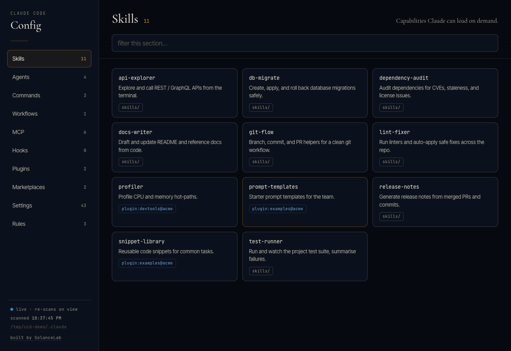
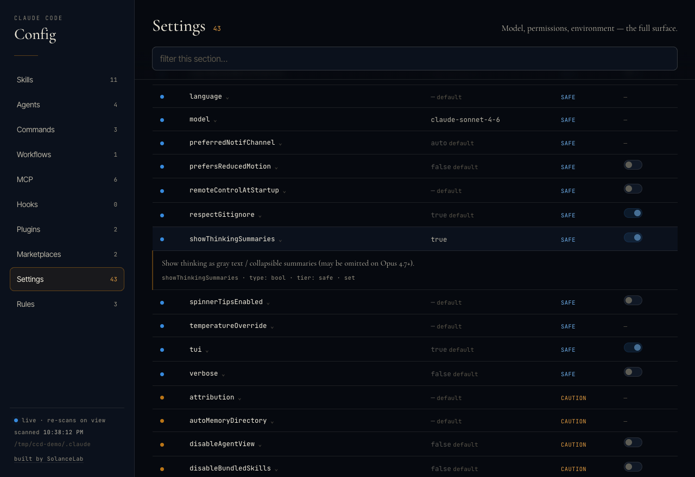
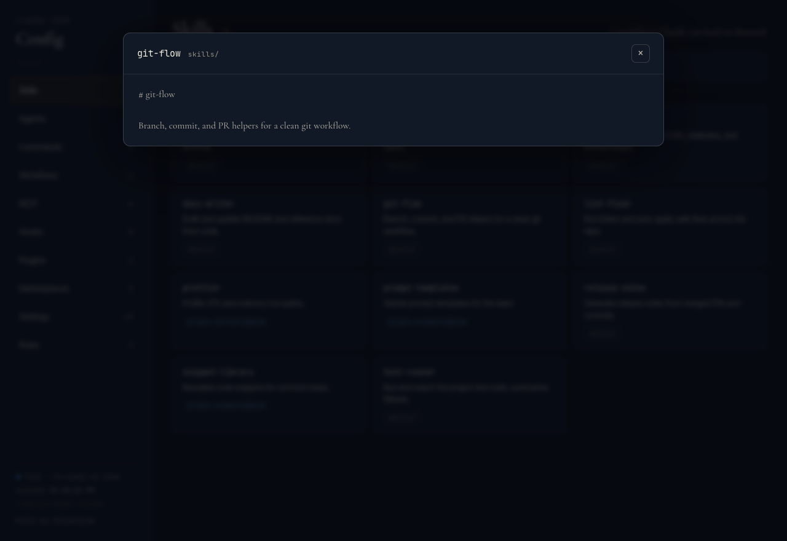

# claude-config-dashboard

Made by House of Solance · free for noncommercial use · credit required

## What it is

A tiny **local, always-fresh dashboard** for everything in your `~/.claude/` — skills, agents, commands, workflows, MCP servers, hooks, scripts, plugins, marketplaces, settings, and rules — in one searchable view.

It runs a small Node server that **scans your filesystem live on every request**, so it can never go stale: there's no cached copy to drift, nothing to regenerate. Open it, and what you see is what's on disk right now.

> Read-only by design. It shows your config; it never changes it.



<p align="center">
  
  
</p>

<sub>Screenshots use sample data, not a real config.</sub>

Claude Code's configuration sprawls across `~/.claude/` (skills, agents, commands, workflows, settings, hooks), the plugin cache, and `~/.claude.json` (MCP servers). There's no single place to see all of it. This is that place.

## What you need

Node 18 or newer, on macOS, Linux or Windows. It runs on your own computer and reads your own `~/.claude/` folder; it is not a cloud service. No install step, no dependencies.

## Install

Requires **Node 18+**. No install step, no dependencies.

```bash
# clone, then:
node server.mjs
# → http://localhost:7373
```

Or run it straight from GitHub without cloning:

```bash
npx github:SolanceLab/claude-config-dashboard
```

### Always-on (optional)

Keep it running so it's always a bookmark away.

**macOS (launchd)** — edit the paths in [`com.solancelab.claude-dashboard.plist`](./com.solancelab.claude-dashboard.plist), then:

```bash
cp com.solancelab.claude-dashboard.plist ~/Library/LaunchAgents/
launchctl bootstrap gui/$(id -u) ~/Library/LaunchAgents/com.solancelab.claude-dashboard.plist
```

**Linux (systemd user service)** — create `~/.config/systemd/user/claude-dashboard.service`:

```ini
[Unit]
Description=Claude Code config dashboard
[Service]
ExecStart=/usr/bin/node %h/path/to/claude-config-dashboard/server.mjs
Restart=always
[Install]
WantedBy=default.target
```

```bash
systemctl --user enable --now claude-dashboard
```

**Windows (Task Scheduler)** — create a task that runs at logon:

```powershell
schtasks /create /tn "ClaudeConfigDashboard" /tr "node \"%USERPROFILE%\path\to\claude-config-dashboard\server.mjs\"" /sc onlogon /rl limited
```

(or just run `node server.mjs` in a terminal when you want it.) On Windows the dashboard reads `%USERPROFILE%\.claude` and `%USERPROFILE%\.claude.json` automatically.

### Platform support

Runs anywhere Node 18+ runs — **macOS, Linux, and Windows**. The server is pure Node; the only OS-specific part is the optional launchd tab, which switches itself off anywhere but macOS; config paths resolve from your home directory automatically. Only the *always-on* setup differs per OS (launchd / systemd / Task Scheduler above) — the dashboard itself is identical.

## Settings

| Var | Default | Purpose |
|-----|---------|---------|
| `PORT` | `7373` | Port to listen on |
| `CLAUDE_DIR` | `~/.claude` | Point at a non-default config dir |
| `CLAUDE_MEMORY_DIR` | auto-discovered | Pin the memory dir (else the most recent `~/.claude/projects/*/memory/`) |
| `CONFIG_FILE` | `~/.claude/dashboard.config.json` | Optional panels + branding (see below). Missing file = plain dashboard |
| `WORKSPACE_DIR` | — | Overrides `workspaceDir` from the config file |
| `CLAIMS_DIR` | — | Turns on the Sessions board for this folder |

### Optional panels (config file)

With no config file the dashboard is exactly the plain view above. Copy [`dashboard.config.example.json`](./dashboard.config.example.json) to `~/.claude/dashboard.config.json` (or point `CONFIG_FILE` at it) and enable what you want. The file is re-read on every scan, so edits apply without a restart. Relative paths resolve against `workspaceDir`; `~` expands.

| Key | What it adds |
|-----|--------------|
| `brand` | `name`, `accent` (an italic word after the name), `eyebrow`, `font` (a font you have installed), `footerText`, `footerUrl` |
| `validator.enabled` | **Validator** section: hook commands whose script is missing, skills/agents/commands without `name` + `description` frontmatter, files with your home-folder path hardcoded (and launchd targets, if the Local tab is on) |
| `sessions` | **Sessions** section: every `*.claim` file in `dir` (lines like `session=…`, `since=…`, `purpose=…`), hiding ones older than `staleHours`. Hidden if the folder doesn't exist |
| `launchd` | **Local** tab, macOS only: agents in `~/Library/LaunchAgents` whose file name starts with one of `prefixes` — schedule, whether the target exists and is executable, loaded / running / last exit. With `logTable`, a markdown table (`file`, the `## <section>` it lives under, `jobColumn`, `logColumn`, `searchDirs`) maps each job to its log, and a dot shows freshness (`freshHours` / `staleHours`) |
| `infraMap` | **Cloud** tab: the `## N. Title` sections of a markdown file (all, or only `sections`). A line `*Verified …*` becomes the section's stamp; lines `HOT: a, b (hint)` become tag groups for each of `tagKeys`. Hidden if the file is absent |
| `statusPanels` | One section per small JSON file: a tag from `statusKey` (dotted path) coloured by `okValues` / `failValues`, the age from `timeKey`, and the file as key/value blocks — or only the dotted paths listed in `fields`. Hidden until the file exists |

The **Local** tab is the only part that runs anything: `plutil -convert json` and `launchctl print` on your own launch agents, read-only, with a timeout. Everything else reads files. New panels send names, basenames and short log-path tails to the page, never full paths, and all text is secret-masked like the rest.

## Tools

- **Sidebar navigation** — one section at a time, each with a live count: Skills · Agents · Commands · Workflows · MCP · Hooks · Scripts · Plugins · Marketplaces · Settings · Rules.
- **Read the source** — click any skill, agent, command, workflow, plugin, or memory entry to read its full file in a modal; click a hook to see its command *and* the body of the script it runs.
- **Scripts** — every executable your config actually runs — hook commands, MCP server entry files, status line, auth helpers — gathered in one section, each click-to-read (package-based MCPs like `npx …` have no local file, so they're skipped).
- **Full settings surface** — every `settings.json` key, badged by safety tier (🟢 safe · 🟡 caution · 🔴 dangerous).
- **MCP servers** — names, transport, and env *key names* from `~/.claude.json`.
- **Live** — the page re-scans every few seconds; the dot pulses when fresh.
- **Filter** — instant search within the active section.
- **Optional panels** (off until you turn them on in a config file) — Validator, Sessions claim board, a launchd **Local** tab (macOS), a **Cloud** tab rendered from your own infrastructure-map markdown, and small JSON **status panels**. See [Optional panels](#optional-panels-config-file).

## Limits

This tool reads your config, some of which is sensitive. It's built to never expose it:

- **Loopback only.** Binds `127.0.0.1` — never `0.0.0.0`. Not reachable from your network.
- **Read-only.** No write endpoints. It cannot modify your Claude Code config.
- **Secrets masked.** Token/key/JWT/PEM shapes are redacted everywhere; environment variables and MCP server configs show **key names only**, never values; MCP `args`, URLs, and headers are never sent.
- **No raw paths on the wire.** File reads use opaque per-scan IDs mapped server-side to an allow-list, so the browser can't request an arbitrary path (no traversal).
- **No dependencies, no telemetry, no network calls** (other than loading fonts from Google Fonts — remove the `<link>` in `server.mjs` to go fully offline).

Even so: this is a local developer tool. Run it on a machine you trust, for your own config.

- The optional panels are off until a config file turns them on.
- The page re-scans every 3 seconds; the Local tab runs `plutil` and `launchctl print` (macOS only) with a timeout.

## How it works

`server.mjs` plus `lib/panels.mjs` (the optional panels), no dependencies. On each `GET /api/data` it walks `~/.claude/` and `~/.claude.json`, masks anything secret-shaped, and returns JSON; the page renders it and polls every 3s. `GET /api/doc?id=N` returns one allow-listed file's contents (masked). That's the whole thing.

### Tests

```bash
npm test
```

## Credit and use

Claude Config Dashboard is made by House of Solance. You're welcome to use it, change it and build on it for any noncommercial purpose, as long as our credit travels with it.

**Keep the credit.** Every copy, changed or not, must carry the licence and this line:
`Required Notice: Copyright (c) 2026 House of Solance (https://github.com/SolanceLab)`
Removing or replacing it breaks the licence.

**Commercial use needs our permission.** Ask us first.

**We look for copies.** When we find our work without its credit, or used commercially without permission, we ask for it to be taken down.

Versions up to and including 1.2.0 were released under the MIT licence and stay MIT for the copies already in use. The PolyForm Noncommercial licence applies from the next version.

## Licence

[PolyForm Noncommercial 1.0.0](LICENSE.md). See [NOTICE.md](NOTICE.md).

## Support

If you find this useful, consider supporting our work:

[](https://ko-fi.com/houseofsolance)

---

*Built by [House of Solance](https://github.com/SolanceLab) — Chadrien Solance & Anne Solance*
